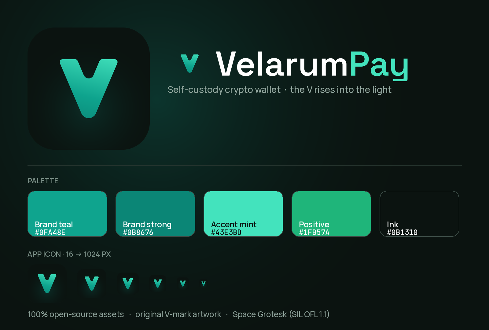

# VelarumPay 品牌素材包（App 图标 + Logo）

这是一套全新的 VelarumPay 视觉标识，核心是一个 **向上的 “V” 字标**——它既是品牌首字母
V，也像一支向上的箭头，寓意「增长」和「支付」。配色和字体完全沿用你项目里现有的
**青绿（teal）设计系统**，并且 **所有素材都用开源、免费、可商用的资源制作**。

如果你是第一次接触这类素材，不用担心——下面会用大白话告诉你每个文件夹是干什么的、该放到哪里。



---

## 一、先看懂两个名词

- **SVG**：矢量图。可以无限放大都不会糊，是「母版」。改颜色、改大小都从它出发。用浏览器或
  设计软件（Figma、Illustrator、Sketch）都能打开。
- **PNG**：位图。固定像素大小，直接能用在网页、文档、商店里。放大会糊，所以我们已经帮你
  导好了各种常用尺寸。

一句话：**要编辑就用 SVG，要直接用就挑对应尺寸的 PNG。**

---

## 二、Logo 设计说明

| 元素 | 说明 |
|---|---|
| 形状 | 向上收窄的「V」字标，圆角柔和，和设计系统里更软的圆角呼应 |
| 渐变 | 底部深青 `#0B8676` → 中间品牌青 `#0FA48E` → 顶部亮薄荷 `#43E3BD`，像「向上发光」 |
| 底色 | 近黑墨色 `#0B1310`（带一点绿调），衬托青绿更亮 |
| 字体 | 字母组合 “VelarumPay” 用 **Space Grotesk**；“Velarum” 用墨色/白色，“Pay” 用品牌青强调 |

---

## 三、配色（可直接复制）

| 名称 | 色值 | 用途 |
|---|---|---|
| Brand teal（品牌青） | `#0FA48E` | 主色、按钮、强调 |
| Brand strong（深青） | `#0B8676` | 渐变底部、按下态 |
| Accent mint（亮薄荷） | `#43E3BD` | 渐变顶部、高光 |
| Positive（上涨绿） | `#1FB57A` | 余额上涨、成功状态 |
| Ink（墨色） | `#0B1310` | 图标底色、深色背景 |

---

## 四、文件夹里有什么 + 怎么用

```
VelarumPay-Brand-Kit/
├─ preview.png            ← 整套效果一览（就是上面那张图）
├─ README.md             ← 本说明
├─ svg/                  ← 矢量母版（要改就改这里）
├─ png/                  ← 导好的位图（拿来即用）
├─ ios/                  ← 直接拖进 Xcode 的 iOS 图标
├─ android/              ← 直接放进 Android 工程的图标
├─ favicon/             ← 网站用的小图标
└─ fonts/OFL.txt         ← 字体的开源授权全文
```

### svg/（设计母版）
- `velarumpay-icon.svg`：圆角 App 图标（青绿 V + 墨色底 + 微光）。
- `velarumpay-icon-square.svg`：方形不带圆角的版本（iOS 系统会自动帮你切圆角，用这个）。
- `velarumpay-mark.svg`：只有渐变 V，背景透明（放在任意底色上）。
- `velarumpay-mark-white.svg` / `-teal.svg` / `-ink.svg`：单色 V（白 / 青 / 墨），用于深底、浅底等不同场景。
- `velarumpay-wordmark.svg`：横版组合标（V + 文字），深色文字，**放在浅色背景**。
- `velarumpay-wordmark-light.svg`：白色文字版，**放在深色背景**。

### png/（拿来即用）
- `icon/icon-16.png … icon-1024.png`：圆角图标的各种尺寸。网页、PPT、文档里直接用。
- `icon-square-1024.png`：方形大图标（做其他平台或商店素材时用）。
- `mark/`：透明背景的 V（渐变 / 白 / 青 / 墨）。
- `wordmark.png` / `wordmark-light.png`：横版组合标（透明背景）。

### ios/（iOS 图标）
里面是 `AppIcon.appiconset`，已经包含全部尺寸和 `Contents.json`。
**用法**：在 Xcode 里打开 `Assets.xcassets`，把现有的 AppIcon 删掉，
再把这个 `AppIcon.appiconset` 文件夹整个拖进去即可。（iOS 图标不能有透明，已为你处理好。）

### android/（Android 图标）
是标准的 `res/` 结构，支持新版「自适应图标」（前景 V + 背景墨色，可被系统裁成圆形/方形/水滴形），
还附带了 **单色图标**（用于安卓 13+ 的主题图标）。
**用法**：把 `android/res/` 里的 `mipmap-*` 文件夹合并到你工程的 `app/src/main/res/` 下即可。
`play-store-512.png` 是上架 Google Play 用的 512×512 图。

### favicon/（网站图标）
- `favicon.ico`：传统网站图标（含 16/32/48/64）。
- `favicon-16/32/48/64.png`、`icon-192.png`、`icon-512.png`：现代浏览器用。
- `apple-touch-icon-180.png`：iPhone「添加到主屏幕」时显示的图标。
- `site.webmanifest`：PWA 配置示例。
把这些放到网站根目录，并在 HTML 的 `<head>` 里引用即可。

---

## 五、授权说明（可放心商用）

这套素材 **100% 由开源 / 免费 / 可商用的资源制成**：

- **图标与 V 字标**：本次原创设计，版权归你（VelarumPay），可自由商用、修改、注册。
- **字体 Space Grotesk**（组合标里用到）：SIL Open Font License 1.1，
  允许商用、嵌入、转曲。为避免依赖字体文件，组合标 SVG 里的文字已 **转成路径（轮廓）**，
  打开即正确显示。
- 设计系统里另两款字体 **Manrope**、**JetBrains Mono** 同为 OFL 1.1。
- 完整授权原文见 `fonts/OFL.txt`。

> 小贴士：OFL 字体唯一的硬性限制是「字体文件本身不能单独售卖」，把它用在你的 App、
> 网站、Logo 里完全没问题。

---

## 六、想改怎么办？

- **换颜色**：打开任意 `svg/` 文件，把里面的 `#0FA48E` 等色值替换即可。
- **重新导出 PNG**：用 Figma / Illustrator 打开 SVG，导出你要的尺寸；或让我帮你重导。
- **要别的尺寸 / 别的底色版本**：告诉我，我直接补给你。
